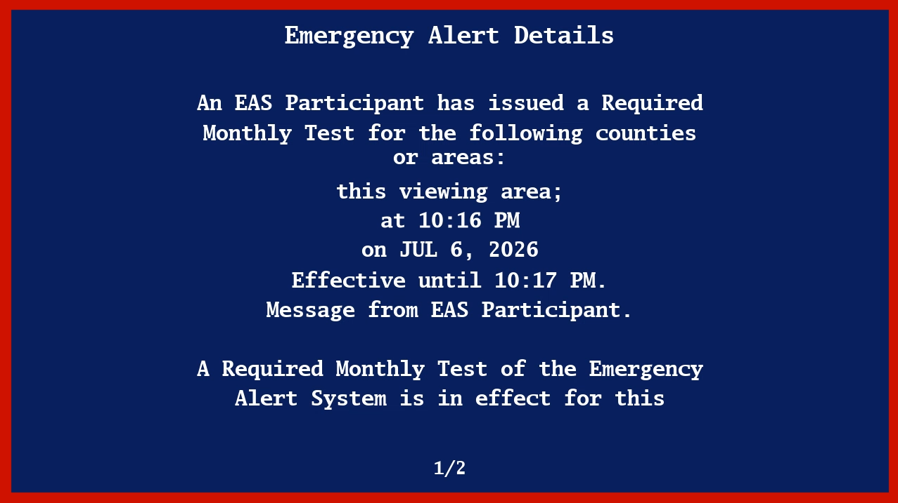
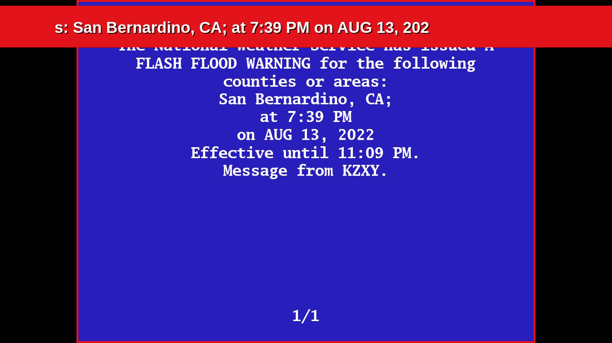
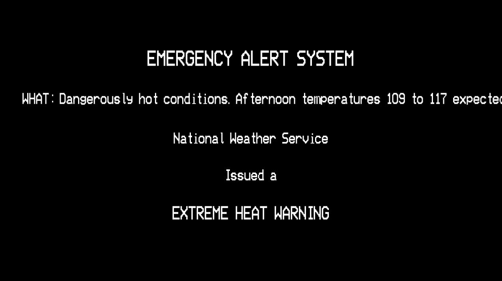
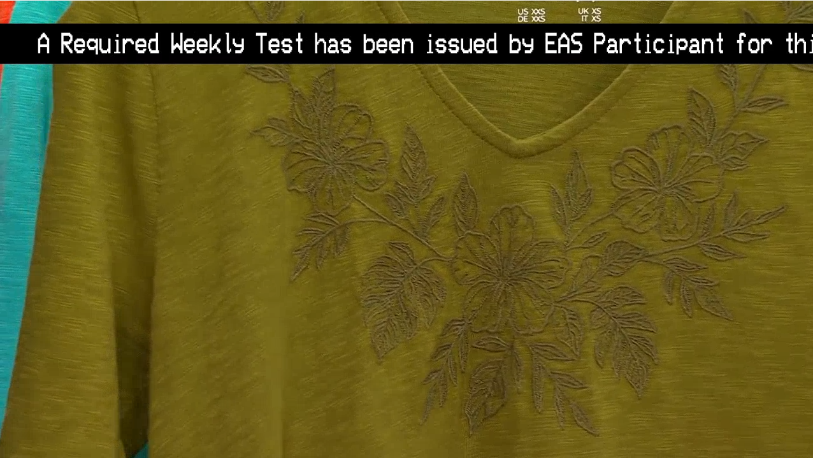

# EmergencyAlertArr

An EAS plugin for Dispatcharr (https://github.com/Dispatcharr/Dispatcharr). It watches the NWS and
IPAWS feeds for active alerts, and when one is issued for your area it interrupts whatever channel
you're watching with a broadcast-style EAS screen and the real SAME/attention tones — then restores
the stream once the alert clears.

It's basically a software ENDEC for your IPTV setup. If you've ever wanted your channels to behave
like real cable during a weather warning, that's the idea.

**Current version: 0.9.10**

## What it does

- Polls the National Weather Service (`api.weather.gov`) and/or FEMA IPAWS-OPEN for active alerts.
- Filters them down to your area by NWS zone/county codes (NWS) and 6-digit SAME/FIPS codes (IPAWS).
- When a new alert is issued, it goes out on the armed channels someone is **actually watching**:
  a broadcast-style alert screen, encoder-accurate SAME header / attention / EOM tones, and a spoken
  readout (or the alert's own IPAWS audio when it carries one).
- Anyone who flips to an armed channel within 5 seconds of the alert going out gets it too.
  Channels nobody is watching are left alone, and an alert nobody saw isn't saved up for later.
- Switches back to the normal stream when the sequence finishes, without the player having to
  reconnect.

Alerts play one at a time, like a real ENDEC, and everything self-restores even if the viewer
wanders off mid-alert.

## Requirements

- **Dispatcharr** (required)
- **FFmpeg** with **libx264** — Dispatcharr already ships a compatible build.
- **Text-to-speech** — nothing to install. A static build of CMU Flite (the same "kal" voice real
  DASDEC units use for IPAWS readouts) is bundled for x86_64 and aarch64. eSpeak NG, Piper or a
  custom command are used instead if you pick them in the settings.

## Overlay styles

<table>
<tr>
<td align="center" width="50%">

<strong>DASDEC</strong>  

  

Navy ENDEC-style details page with a red border and paginated alert text.

</td>

<td align="center" width="50%">

<strong>SARA set-top firmware</strong>  

  

Red paged bar drawn by the set-top box, over the program or the headend's alert page.

</td>
</tr>

<tr>
<td align="center">

<strong>EASyPlus</strong>  

  

Full-screen black takeover with centered text and a scrolling line.

</td>

<td align="center">

<strong>EASyPlus Ticker</strong>  

  

Program keeps playing underneath a scrolling alert banner.

</td>
</tr>
</table>

Full list of screen styles:

- **DASDEC:** classic, 2007–2016 all-caps, black, plain blue, red, and classic page with a red or
  black crawl bar.
- **EASyPLUS:** classic, middle scroll, bottom scroll, grey, light grey, ticker only.
- **Others:** EASyCAP, Gorman-Redlich EAS-1CG (pages, or keyed over the program), VDS 840 /
  Sub-Alert, set-top box ticker, CG crawl over the program, and SARA set-top firmware.

Each style uses the matching encoder's tone framing, so a SAME decoder identifies the "encoder" the
way it would identify the real unit.

## Install

Drop the plugin folder into your Dispatcharr `plugins` directory (it's self-contained), or install
the release zip. Then open the plugin settings and work through the numbered sections:

1. **Channels** — pick what gets alerts (one channel, a group, several groups, or all channels). Then
   press **Enable EAS**. Arming every channel is fine — only the ones being watched switch over.
2. **Your area** — choose NWS, IPAWS or both, and enter the matching zone / SAME codes.
3. **Alert screen** — choose a style. Optionally pick an "EAS details" channel for the Motorola-style
   force-tune look.
4. **Sound** — loudness (−24 LKFS by default, the CALM Act level), tone level, program audio
   (switch / duck / mute), voice.
5. **Tests** — schedule Required Weekly/Monthly Tests or use the test locations.
6. **Custom alert** — templates and text for **Inject Custom Alert**.
7. **Relay rules & monitoring** — what happens to RWT/RMT and other event codes (relay, hold N
   minutes, log only, ignore). There is also an optional channel to monitor for real SAME tones.
8. **Advanced** — you normally don't need to touch this.

## Actions

- **Enable / Disable EAS** — arm or unarm the selected channels.
- **Test EAS Alert** / **Inject Custom Alert** — fire a test or your own alert on the selected
  channels that someone is watching right now. If nobody is watching, it tells you instead of
  firing; anyone tuning in within 5 seconds still gets it.
- **Stop All Alerts Now** — panic button: ends everything on screen and marks the current feed as
  already announced.
- **View Armed Channels / View & Clear Alert History / Diagnostics / Restart Alert Checking /
  Clean Up Leftover Alert Profiles / Reset Everything** — housekeeping.

## Notes

- **Timing:** new alerts are picked up on the next poll (60 s by default). Switching a channel over
  takes about 2–3 seconds, while Dispatcharr restarts the channel on the alert.
- **CPU:** the alert is rendered at 1080p by default. On a weak CPU, set **Alert video
  resolution** to 720p.
- **National test mode:** receives every alert in the country, for testing. Turn it off for
  normal use — it produces a constant stream of alerts.

## Changelog

- **0.9.10** — the alert follows its own stream: if it restarts in the first seconds it plays
  again from the top instead of dropping back to the normal channel (fixes "the stream just pauses
  and comes back normal"); more tolerant of slow-reconnecting players.
- **0.9.9** — Test/Inject only fire on watched channels (they built an alert for every armed
  channel, which took minutes and ended in a 504); cleaner channel switch with several viewers.
- **0.9.8** — no per-channel work with every channel armed (big CPU/database reduction).
- **0.9.7** — an alert nobody saw isn't saved for the next channel you flip to; the alert is taken
  off a channel once its viewer leaves.
- **0.9.6** — alerts only on channels that are being watched, plus the 5-second join window.
- **0.9.0–0.9.5** — encoder-accurate tones and loudness, priorities and relay rules, proper EAN
  handling, IPAWS audio, channel monitor, templates, force-tune look, seamless return to the
  channel, no double-played alerts.

## Responsible use

This generates the real EAS tones, so keep it on your own private setup. The SAME and attention tones
are the genuine article — don't point the test or inject features at anything public, and don't
rebroadcast the tones anywhere they could be mistaken for an actual alert.
